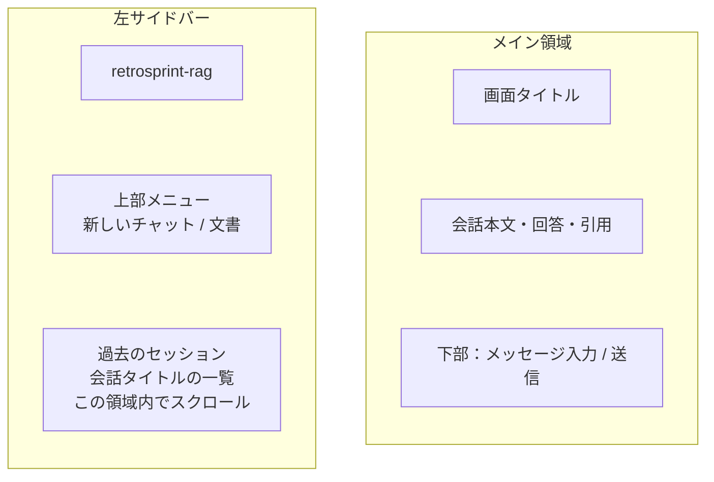
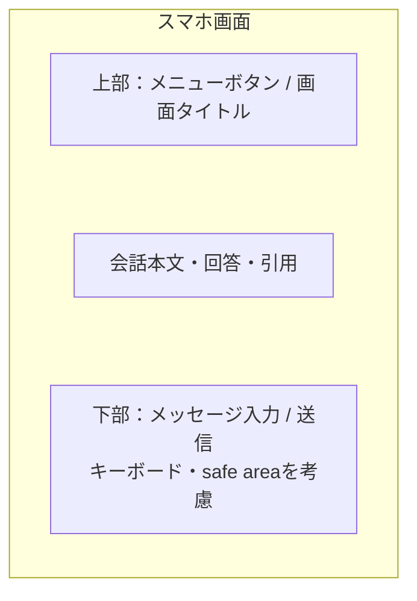
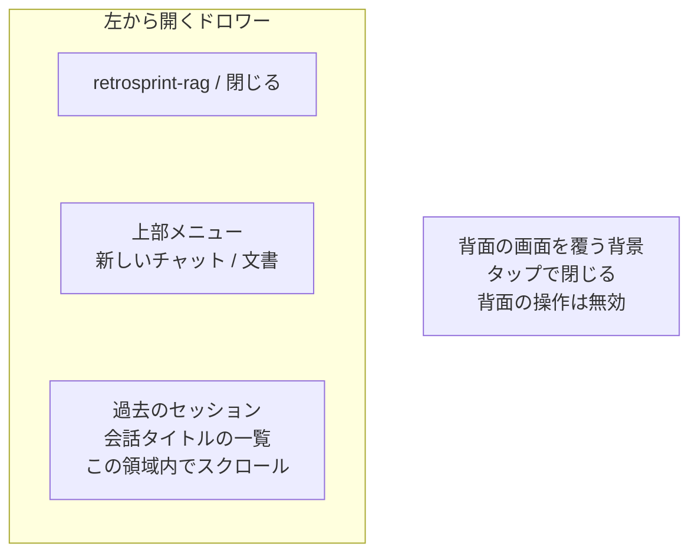
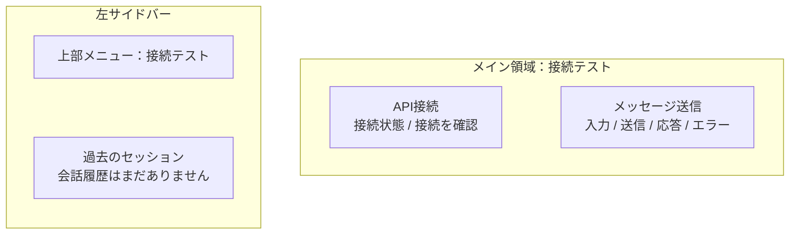
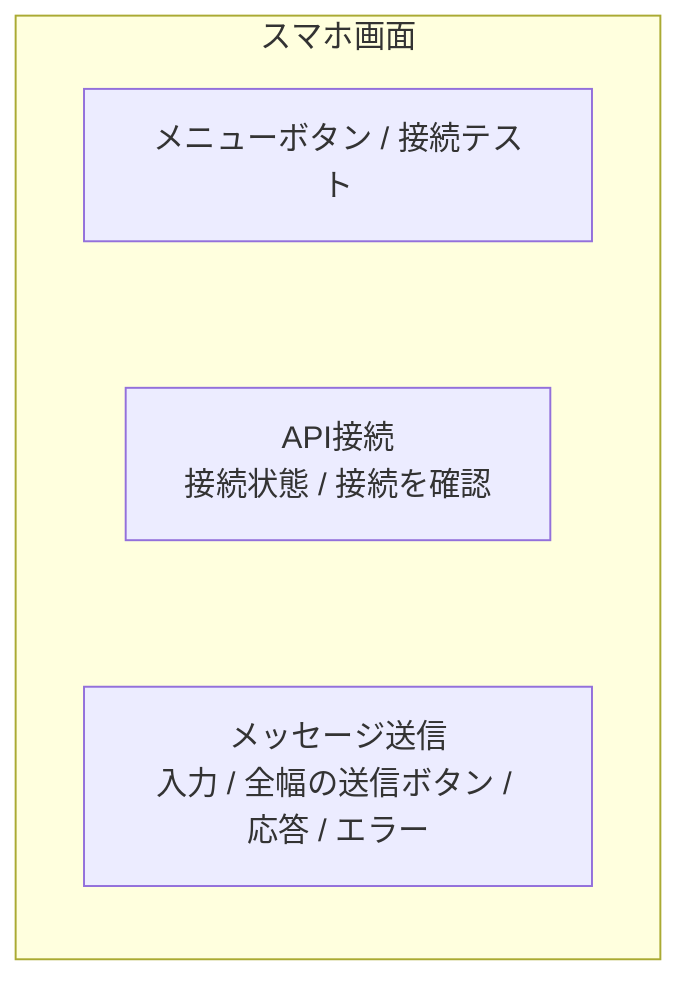

# フロントエンドの画面とコンポーネント

状態：実装計画。画面は未実装。最初は [Issue #2](https://github.com/qei-2027-700/retrosprint-rag/issues/2) の疎通確認画面を作り、業務画面は機能仕様を具体化してから追加する。

## 最初に作る疎通確認画面

ルート `/` に、APIの接続確認と文字列の送受信を行う開発用画面を置く。API契約・入力制約はIssue #2を参照する。チャットや文書管理の完成とは扱わず、将来の公開画面のナビゲーションには含めない。

### 共通レイアウト

ChatGPTのように、左サイドバーと右のメイン領域で構成する。サイドバーは上部をメニュー、その下の残りの領域を過去のセッション一覧に使う。過去のセッションは会話履歴を指す。

Mermaid対応のMarkdownビューアで、以下の図を表示する。各ブロックは画面内の配置を示し、通信や処理の順序は表さない。幅・余白の比率は模式的なものとする。

#### PC：チャット画面



#### スマホ：通常表示



#### スマホ：メニューを開いた状態



#### 初期の疎通画面：PC



#### 初期の疎通画面：スマホ



初期画面のスマホ用ドロワーも、上部を「接続テスト」、その下を空の履歴表示とする。

PCではサイドバーを幅260px程度で常時表示する。上部メニューを残し、長くなった過去のセッション一覧はその領域内でスクロールする。メイン領域は残りの幅を使い、本文・入力の最大幅は読みやすい幅に制限する。

768px未満はサイドバーを閉じ、上部のメニューボタンから開くドロワーにする。ドロワー内の並びはPCと同じにする。選択後・閉じるボタン・背景タップ・Escapeで閉じ、フォーカスを適切に管理する。開いている間はフォーカスが背景へ抜けず、閉じたら元の操作へ戻るようにする。

図のチャット入力は業務画面で追加する。初期の疎通画面では、メイン領域に接続確認カードとechoフォームを置く。PCはカードを横並び、スマホは縦並びとする。サイドバーのメニューは実装済みの「接続テスト」だけを表示し、セッション領域は「会話履歴はまだありません」と表示する。架空の履歴や未実装の業務操作を動作済みとして表示しない。

スマホの左右余白は16px程度、カード内余白は16〜24px程度を出発点とする。入力欄・カードは親幅に収まり、長文・URL・連続文字列も折り返す。画面全体の横スクロールを発生させない。

入力はlabel付きtextarea、ボタンは通常のbuttonを使う。スマホの送信ボタンは全幅、操作領域の高さは44px以上を設計目標とする。入力欄の文字は16px以上を基本とする。スマホのキーボード表示時も入力・送信・応答へアクセスできるようにする。チャットの入力欄を下部へ配置する際は動的な画面高とsafe areaを考慮し、本文や最後のメッセージを隠さない。

各幅・余白は初期値であり、実装時の実画面確認で調整する。

### 状態と操作

| 対象 | 状態と表示 |
| --- | --- |
| 接続確認 | 未確認 → 確認中 → 接続できました / 接続できませんでした。再確認可能 |
| 入力 | 未入力時は送信不可。入力制約の説明と、入力エラーを入力欄の近くに表示 |
| 送信 | 送信中は同じ操作を重複させない。送信対象の入力を固定し、応答と対応付ける |
| 成功 | BEが返した文字列を応答欄に表示。初期状態の案内と区別する |
| 失敗 | 422と通信失敗を分けて表示。入力を保持し、修正・再送できる |

接続確認とechoは別の通信として扱い、接続確認が成功していなくてもechoを試せる。どちらかの失敗で画面全体を利用不可にしない。

再送時は前回の成功表示を消すか「前回の応答」と明示し、新しい通信の結果と取り違えないようにする。新しい送信中は入力を変更不可にする初期案とし、別の入力に対する応答が現在の入力の結果として表示されることを防ぐ。

422は契約テストに加え、実ブラウザの通信経路でも確認する。画面で入力不正を防いでも、API側のバリデーションは維持する。ネットワークエラーはHTTPのエラー応答と別に捕捉する。

### コンポーネントと通信処理

初期の責務別配置は次の範囲とする。単純なlabel、ボタン、エラー文、応答表示をそれぞれ別コンポーネントにしない。

```text
frontend/app/
├── layouts/default.vue              # サイドバー・モバイルヘッダー・メイン領域
├── components/AppSidebar.vue        # 上部メニュー・下部セッション一覧
├── pages/index.vue                  # 疎通画面の配置・見出し
├── components/connectivity/
│   ├── ApiHealthCard.vue            # 接続確認と状態表示
│   └── EchoFormCard.vue             # 入力・送信・応答・エラー表示
├── composables/useConnectivity.ts   # 通信状態・API呼び出し・例外の整理
└── api/
    ├── client.ts                    # base URLと生成型を使うHTTPクライアント
    └── generated/schema.d.ts        # OpenAPIから生成
```

pageはレイアウトを担当し、composableが接続確認・echoそれぞれの状態と操作を提供する。カードはpropsで状態を受け取り、操作をemitする。composableはpageで一度呼び出し、カードごとに重複した状態を作らない。`client.ts` は通信の共通設定、Pydantic/OpenAPIは契約、componentsは表示を担当する。

共通レイアウトとサイドバーは初期から用意する。メニュー・履歴はまず `AppSidebar.vue` 内にまとめ、機能やファイルが増えてから分割する。最初から全体用の状態管理ライブラリや汎用フォーム基盤は追加しない。

### アクセシビリティ

見出しの順序、labelと入力欄の関連付け、キーボード操作、フォーカス表示を確認する。状態を色だけで伝えず、文字を添える。通信結果は `aria-live`、入力エラーは `aria-describedby` と `aria-invalid` 等で関連付ける。送信後の応答表示でフォーカスを不用意に移動させない。

### 確認する画面幅と完了条件

| 幅 | 確認内容 |
| --- | --- |
| 320px・390px | サイドバーの開閉、カード1カラム、ボタン全幅、折り返し、横スクロールなし |
| 768px | サイドバー常時表示への切り替え境界で本文・入力欄がはみ出さない |
| 1280px | 左上のメニュー・その下の履歴、長い履歴のスクロール、本文の最大幅・余白 |

各幅で未確認・通信中・成功・入力エラー・通信失敗を確認する。E2Eはスマホ幅とPC幅で実BEへの送信・応答表示を検証する。生成した静的サイトでも疎通を確認する。

スマホ幅の自動テストだけで実端末確認済みとは扱わない。可能な段階で実機の縦横表示・キーボード・拡大表示も確認し、未確認ならその範囲を記録する。

## 業務画面の方向性

共通レイアウトは上記の方針を採用する。以下の業務機能は後続で設計・実装し、URL・API・権限・データの詳細は各機能specで決める。

| 画面・機能 | PCの方向性 | スマホの方向性 |
| --- | --- | --- |
| ログイン | ログイン案内とCognitoへの導線 | 1カラム・主要操作を全幅 |
| チャット・履歴 | 左上のメニューとその下のセッション一覧、右に本文と下部入力 | メニューボタンで同じサイドバーを開閉 |
| 引用・出典確認 | 回答から詳細パネル等で根拠を開く | 詳細画面または閉じられるパネル |
| 文書一覧・取り込み状態 | 一覧、検索・絞り込み、管理者向け登録操作 | カード一覧、状態と主要操作を優先 |
| 文書登録 | ファイル選択、進捗・結果・再試行 | ドラッグ操作に依存せずファイル選択で操作 |

通常ユーザーに管理者の文書登録操作は表示しない。APIでも権限を確認する。業務画面を追加する際には「どの操作がどのAPIを呼び、どの状態とエラーを表示するか」をspecと合わせて設計する。

セッション一覧は更新日時の新しい順を初期案とし、タイトル・選択中・履歴なし・取得中・取得失敗を扱う。取得するAPI・ページング・削除操作は会話履歴のspecで決める。メニューの正式な項目・権限・URLも各業務機能の設計時に確定する。
